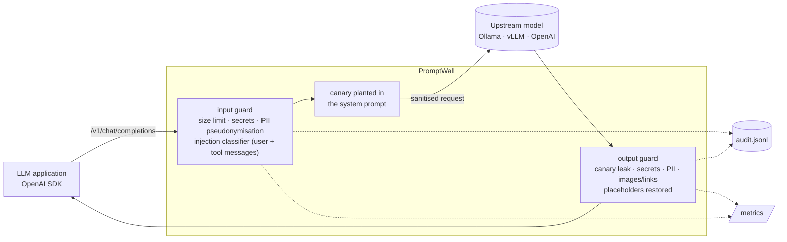
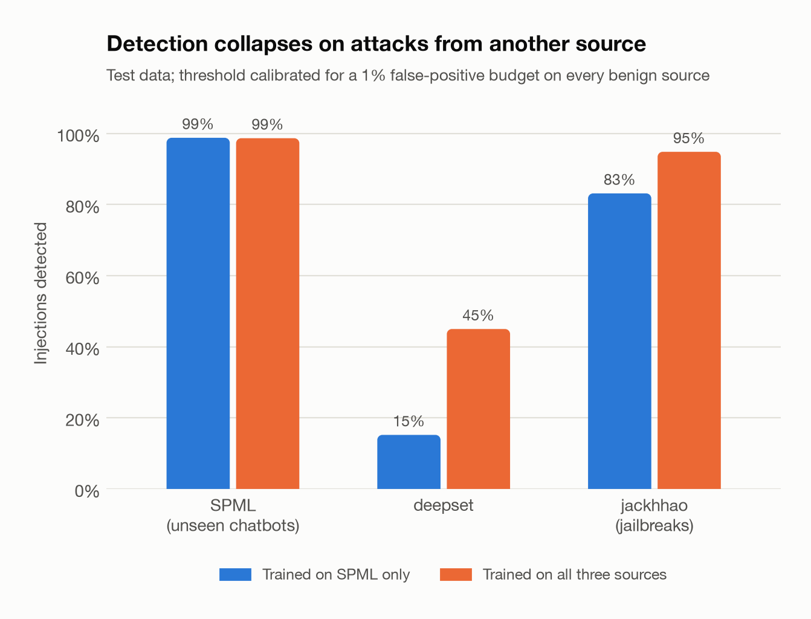
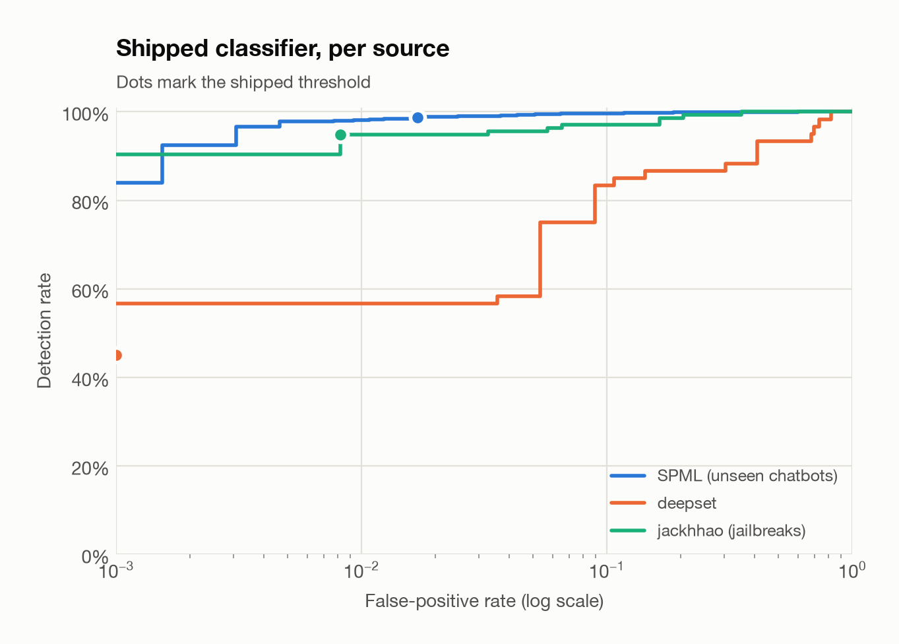

# PromptWall: an LLM firewall

[](https://github.com/hugo-kte/promptwall/actions/workflows/ci.yml)


PromptWall is a reverse proxy that speaks the OpenAI chat API and sits between an LLM application
and its model (Ollama, vLLM, OpenAI, any compatible endpoint). Point the application's
`base_url` at it and every exchange is inspected on the way in and on the way out:

* **personal data is pseudonymised** before it leaves (`[EMAIL_1]`) and restored in the
  answer, so the provider never sees it;
* **credentials are blocked** before they reach a third-party model;
* **prompt injections are blocked** by a classifier trained on public datasets, including
  injections carried by tool and RAG content;
* **system-prompt leaks are caught** with a canary token, even when encoded;
* **exfiltration through rendered images and links is neutralised** in the output;
* every decision lands in a **privacy-preserving audit log** and in **Prometheus metrics**.

It adds about **2 ms** per request and can run in **monitor mode** (log, never block) for a
safe rollout.

## Results at a glance

| Control | How it was measured | Result |
|---|---|---|
| Injection classifier, SPML chatbots never seen in training | 3,148 prompts | **98.7%** detected, 1.7% false positives |
| Injection classifier, jailbreak dataset (jackhhao) | 258 prompts | **94.9%** detected, 0.8% false positives |
| Injection classifier, deepset dataset | 116 prompts | **45.0%** detected, 0% false positives |
| Benign generic instructions (Dolly) | 2,989 prompts | **0.03%** false positives |
| PII detection (6 entity types, checksums) | 2,000 synthetic sentences with hard negatives | **99.7%** precision, **100%** recall |
| Guard overhead per request | 300 requests, input + output scanners | **2.3 ms** p50, 5.5 ms p95 |

**Key findings**

1. **Classifiers do not generalise across attack styles.** Trained on one dataset, the model
   catches 99% of new injections from that dataset but only **15%** of those from another one.
   Training on three sources lifts that to 45%, and jailbreak detection from 83% to 95%. An
   injection classifier is one layer of defence, never the wall itself.
2. **Calibrate on the traffic you protect, source by source.** A threshold calibrated on the
   pooled benign data looks excellent on generic prompts (0.2% false positives) but blocks
   **4%** of real chatbot questions. Calibrating so that *every* benign source meets the 1%
   budget brings that to 1.7%, at a cost of 0.4 points of detection.
3. **Deterministic checks do the heavy lifting where they can.** Checksum-validated PII,
   documented key formats and canary tokens make no probabilistic guesses: the classifier is
   only used where nothing deterministic exists.

## How it works



| Control | OWASP LLM Top 10 (2025) | Default action |
|---|---|---|
| Injection classifier on `user` and `tool` messages | LLM01 Prompt Injection | block |
| PII pseudonymisation (e-mail, phone, card, IBAN, French NIR, IP) | LLM02 Sensitive Information Disclosure | redact (reversible) |
| Secret detection (cloud keys, tokens, private keys, `password=`) | LLM02 | block in, redact out |
| Canary token in the system prompt | LLM07 System Prompt Leakage | block |
| Remote images and links in the output | LLM05 Improper Output Handling | redact |
| Request size limit, per-client rate limiting | LLM10 Unbounded Consumption | block / HTTP 429 |

What the proxy cannot see (tool authorisation, retrieval stores, model supply chain) is
discussed in the [threat model](docs/THREAT_MODEL.md).

## Quickstart

```bash
git clone https://github.com/hugo-kte/promptwall.git && cd promptwall
make install        # .venv + dependencies
make data           # 4 public datasets, ~20 MB
make evaluate       # trains and evaluates the classifier, writes reports/ (~4 min)
```

Run the firewall in front of a local [Ollama](https://ollama.com) model and use any
OpenAI-compatible client:

```bash
ollama pull llama3.2:3b
make serve          # http://127.0.0.1:8080/v1 -> http://localhost:11434/v1
```

```python
from openai import OpenAI

client = OpenAI(base_url="http://127.0.0.1:8080/v1", api_key="unused")
reply = client.chat.completions.create(
    model="llama3.2:3b",
    messages=[{"role": "user", "content": "My card 4111 1111 1111 1111 was charged twice."}],
)
```

`make demo` sends a request containing personal data through the firewall to the local model
and shows what each side saw. A real run with `llama3.2:3b`:

```text
──────────────────────────── user sent ────────────────────────────
Hi, I'm Claire. Please write a two-sentence reply confirming that the order confirmation will be
sent to claire.martin@example.com and that we may call her on +33 6 12 34 56 78 if needed.
───────────────────── upstream model received ─────────────────────
Hi, I'm Claire. Please write a two-sentence reply confirming that the order confirmation will be
sent to [EMAIL_1] and that we may call her on [PHONE_1] if needed.
─────────────── user received (HTTP 200, action redact) ───────────
Hi Claire, We have confirmed your order and will be sending you a confirmation email to
claire.martin@example.com. If you have any questions or concerns, please don't hesitate to reach
out to us on +33 6 12 34 56 78 and we'll be happy to assist you further.
```

Other commands: `promptwall scan "<text>"` shows what the input guard would do with one
message, `promptwall info` prints the shipped model's manifest. With Docker:

```bash
docker build -t promptwall .
docker run -p 8080:8080 -v "$PWD/artifacts:/app/artifacts:ro" promptwall \
    serve --host 0.0.0.0 --policy configs/policy.yaml
```

Inside a container, `localhost` is the container itself: set `upstream.base_url` to
`http://host.docker.internal:11434/v1` to reach an Ollama running on the host.

## Policy

Everything is driven by [`configs/policy.yaml`](configs/policy.yaml), validated strictly at
start-up (unknown keys are errors, not silently ignored):

```yaml
mode: enforce              # or monitor: log every decision, change nothing
block_response: error      # HTTP 403 with an OpenAI-style error, or a refusal completion
upstream:
  base_url: http://localhost:11434/v1
input:
  injection: {action: block, roles: [user, tool]}
  pii: {action: redact, entities: [EMAIL, PHONE, CREDIT_CARD, IBAN, FR_NIR, IP_ADDRESS]}
  secrets: {action: block}
output:
  canary: {action: block}
  links: {action: redact, allowed_domains: [docs.example.com]}
audit:
  store_text: false        # the audit log keeps decisions, not conversations
```

Each response carries `X-PromptWall-Request-Id` and `X-PromptWall-Action` headers that match
the audit log. Streaming clients are supported: the upstream answer is buffered, inspected, then
re-emitted as a server-sent event stream, because an output filter cannot release tokens it has
not seen yet.

## The injection classifier

A TF-IDF model on word (1-2) and character (3-5) n-grams with logistic regression: under 2 ms
per prompt on a laptop CPU, no GPU, and its decisions can be audited feature by feature.

| Source (Hugging Face) | Licence | Rows | Role |
|---|---|---:|---|
| `reshabhs/SPML_Chatbot_Prompt_Injection` | MIT | 16,012 | training; split **by system prompt**, so test chatbots are unseen |
| `deepset/prompt-injections` | Apache-2.0 | 662 | second source (English and German) |
| `jackhhao/jailbreak-classification` | Apache-2.0 | 1,306 | third source (jailbreaks vs. benign role-play) |
| `databricks/databricks-dolly-15k` | CC BY-SA 3.0 | 15,011 | benign instructions, false-positive estimate |

Evaluation prompts that also appear in a training split are removed, and the threshold is
calibrated on validation data only, for a 1% false-positive budget on each benign source.



| Experiment | SPML (unseen chatbots) | deepset | jackhhao | Dolly FPR |
|---|---:|---:|---:|---:|
| **Shipped: three sources, per-source calibration** | **98.7%** / 1.7% | **45.0%** / 0% | **94.9%** / 0.8% | 0.03% |
| One source (SPML), other datasets unseen | 98.8% / 2.0% | 15.2% / 1.0% | 83.2% / 6.7% | 0.00% |
| Three sources, pooled calibration | 99.1% / 4.0% | 55.0% / 0% | 97.1% / 6.6% | 0.20% |
| Three sources, word n-grams only | 96.4% / 0.3% | 28.3% / 0% | 89.0% / 1.6% | 0.00% |
| Three sources, character n-grams only | 96.8% / 0.6% | 23.3% / 0% | 89.7% / 0% | 0.00% |

Cells are detection rate / false-positive rate on test data. Word and character n-grams are
complementary: either alone loses 2 to 22 points of detection.



On deepset the shipped threshold sits below what that source alone would allow: the threshold
is set by the hardest benign source (in-context chatbot questions), which is the price of
keeping the false-positive budget everywhere.

## PII detection

Regular expressions find candidates; checksums decide. Card numbers need a Luhn check and an
issuer prefix, IBANs the ISO 13616 mod-97 check, French social security numbers their 2-digit
key; when two candidates overlap, the stricter check wins. The synthetic benchmark mixes support
tickets in English and French with hard negatives (order numbers, invoice references, dates,
versions, prices, tracking codes):

| Entity | Precision | Recall |
|---|---:|---:|
| EMAIL, PHONE, IBAN, FR_NIR, IP_ADDRESS | 100% | 100% |
| CREDIT_CARD | 98.2% | 100% |

The remaining errors are 16-digit order numbers that happen to carry a valid issuer prefix and
pass the Luhn check: they are indistinguishable from card numbers without context.

## Project structure

```text
src/promptwall/
├── scanners/      pii.py (+ pseudonymisation), secrets.py, canary.py, links.py, pii_benchmark.py
├── classifier/    data.py (datasets, leakage-free splits), model.py, evaluate.py
├── proxy/         app.py (FastAPI), pipeline.py (input/output guards), telemetry.py, bench.py
├── config.py      strict pydantic policy
├── report.py      experiments -> reports/
└── cli.py         download · evaluate · serve · scan · demo · info
configs/policy.yaml
reports/           metrics.json, REPORT.md, figures/
docs/THREAT_MODEL.md
tests/             43 tests, no network or dataset needed
```

## Limitations

* **The classifier is lexical.** It catches known styles of injection and misses paraphrases
  it has never seen (45% on deepset). A fine-tuned transformer would generalise better, at a
  higher latency and hardware cost.
* **English first.** Character n-grams help with German, but other languages are untested.
* **PII coverage stops at structured identifiers.** Names and postal addresses need named
  entity recognition; the benchmark is synthetic and measures the detector's logic, not its
  coverage of every real-world format.
* **The canary catches verbatim and encoded leaks, not paraphrases** of the system prompt.
* **Streaming is buffered**, so the first token arrives when the whole answer is ready.
* **The rate limiter is per process**; several replicas need a shared store such as Redis.

## Roadmap

- [ ] Small transformer detector in an ensemble with the n-gram model, on CPU via ONNX.
- [ ] Named-entity recognition for names and addresses.
- [ ] Incremental output scanning to release tokens early when streaming.
- [ ] Per-tenant policies and a Redis-backed rate limiter.
- [ ] OpenTelemetry traces next to the Prometheus metrics.

## References

* OWASP, *Top 10 for Large Language Model Applications*, 2025 edition.
* K. Greshake et al., *Not what you've signed up for: Compromising Real-World LLM-Integrated
  Applications with Indirect Prompt Injection*, AISec 2023.
* R. K. Sharma, V. Gupta, D. Grossman, *SPML: A DSL for Defending Language Models Against
  Prompt Attacks*, 2024 (source of the SPML dataset).
* Protect AI, *Rebuff* (canary-word leak detection).
* M. Conover et al., *Free Dolly: Introducing the World's First Truly Open Instruction-Tuned
  LLM*, Databricks, 2023.

## License

[MIT](LICENSE). Datasets are downloaded from their sources and keep their own licences.
